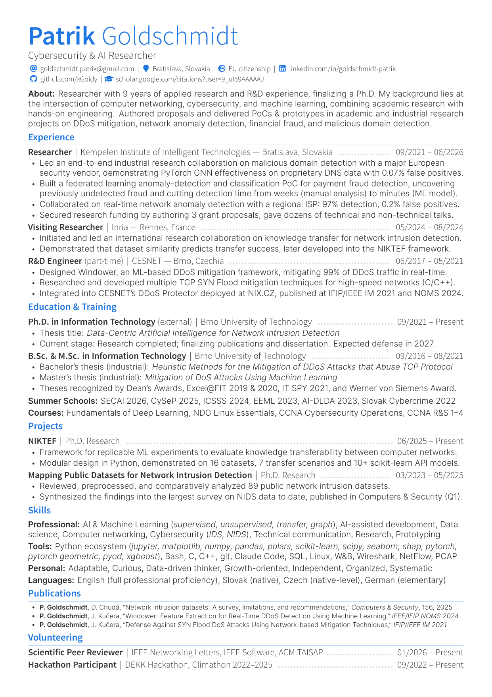
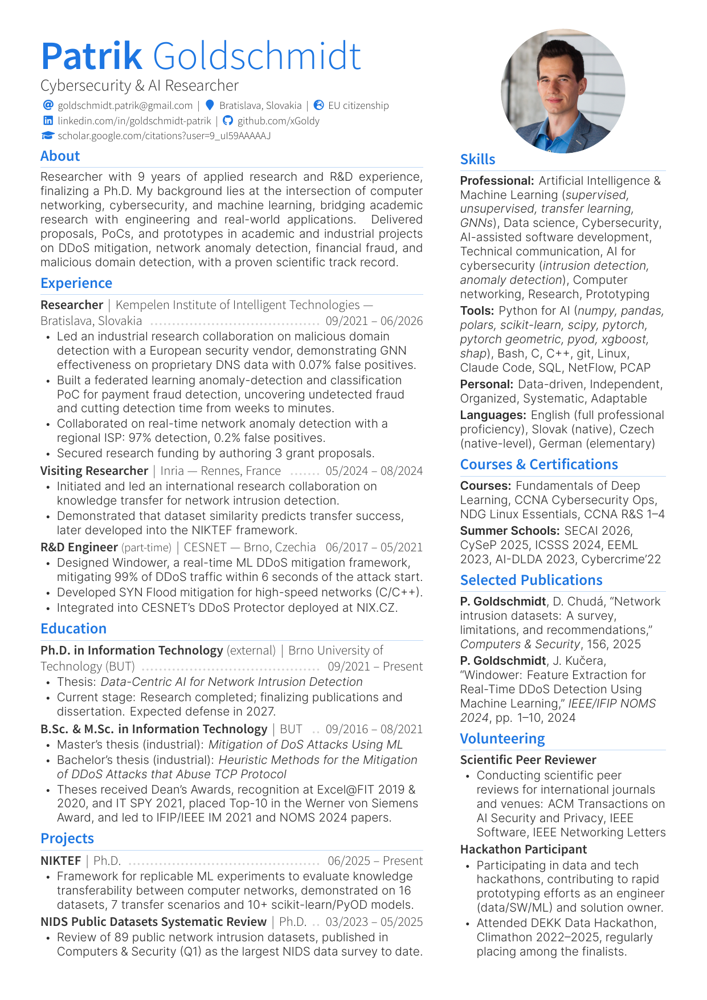

# Lucid CV


[](https://github.com/xGoldy/lucidcv/releases/latest)


[](https://ko-fi.com/Z6Q8280XSJ)

Lucid CV is a LuaLaTeX class for creating modern, ATS-friendly resumes (CVs). It combines a design inspired by [PlushCV](https://github.com/cystema/PlushCV) with a custom back-end supporting extensive customization, single- and two-column layouts, and, above all, **designed and tested compatibility with common PDF parsers and text extractors**.

---

**Author:** Patrik Goldschmidt (<goldschmidt.patrik@gmail.com>)\
**Maintainer:** Patrik Goldschmidt (<goldschmidt.patrik@gmail.com>)\
**Bug reports:** [https://github.com/xGoldy/lucidcv/issues](https://github.com/xGoldy/lucidcv/issues)

---

The class's name reflects its main goal: a resume that is _lucid_, i.e., clear and easy to understand for humans and machines alike. However, many modern resumes prioritize visual appeal at the expense of machine readability, causing Applicant Tracking Systems (ATSs) and PDF extraction tools to misinterpret or extract their content incorrectly. Lucid CV aims to tackle this issue and provide the best of both worlds: a resume that is visually appealing to humans while remaining machine-readable.

Colors, fonts, text sizes, spacing, layout, and other design elements can be customized without compromising document parsability.

This README covers the class's features, setup, usage, and ATS-compatibility testing and should be sufficient for most use cases. For detailed design information, see [docs.md](resources/docs.md) (fully AI-generated).

> **Note:** The Overleaf and CTAN packages include the class, sample, and README, but not the test suite, extended documentation in `resources/`, and the `build.sh` script. To obtain these files, e.g., for ATS-compatibility testing described in [Section 5](#5-testing-for-ats-compatibility), get the full project from the [GitHub repository](https://github.com/xGoldy/lucidcv).

## Table of Contents

1. [Features](#1-features)
2. [Examples](#2-examples)
3. [Getting Started](#3-getting-started)
4. [Usage](#4-usage)
5. [Testing for ATS Compatibility](#5-testing-for-ats-compatibility)
6. [License](#6-license)
7. [Support the Project](#7-support-the-project)

## 1. Features

- **Modern, clean design.** Inspired by [PlushCV](https://github.com/cystema/PlushCV) with bundled Inter, Source Sans 3 and Source Code Pro fonts, a single accent color driving the palette, section heading rules, and Font Awesome 5 icons in the contact line. These choices aim to remain visually appealing without compromising machine readability (see [ATS Compatibility as a Design Priority](#ats-compatibility-as-a-design-priority)).
- **PDF/A-2b, PDF/UA-1 and tagged PDF.** The output conforms to the PDF/A-2b standard for long-term archiving and to the PDF/UA-1 standard for accessibility, and includes a tagged document structure: headings use `H2`/`H3`, the photo is a `Figure` with alternative text, links carry a description, decorative rules, leaders and icons are marked as artifacts. Title, author, and subject are populated automatically from the header. This improves interoperability with PDF readers, screen readers, and parserss.
- **Customizable without touching the class.** Accent color in any color model, margins, column ratio, font sizes, and the spacing between items, entries, and sections can all be configured from the preamble (see [Preamble](#preamble)).
- **One content file, multiple layouts.** The same body can be typeset in one or two columns, and at regular or compressed density, by changing class options only. Column breaks are safely ignored in the single-column layout, so there is no need to maintain separate versions of the content.
- **Header with contact fields and photo.** Predefined contact fields (email, phone, address, location, homepage, LinkedIn, GitHub, ORCID) display their full service prefix (e.g., `github.com/xGoldy`) and can be turned into clickable links. Custom fields with icons can also be declared. A circular photo can be added to the header and enabled or disabled with a single class option.
- **Flexible entry system.** Resumes are composed of entries supporting stacked or one-line layouts, flush-right dates, and configurable per-entry spacing. Entry hierarchies (e.g., one company, multiple job positions) are supported by indented groups of sub-entries.
- **Extra elements.** Predefined skill chips, reference entries, dashed dividers, and an optional _Last update_ timestamp can be added.
- **Additional tooling.** In addition to Overleaf support, the project includes a local build script and a comprehensive ATS test suite (see [Testing for ATS Compatibility](#5-testing-for-ats-compatibility)).

### ATS Compatibility as a Design Priority

A PDF that looks good on screen says nothing about what a parser can extract from it. A regular PDF stores only text glyphs and their positions. Word spaces, line breaks, and reading order must then be inferred by individual extraction tools, which may produce different results.

Because many resume templates are validated primarily by visual inspection, their extracted text might contain merged words, icons turned into random characters, interleaved columns, or dates detached from their entries. In contrast, Lucid CV was designed and validated against what extractors actually return, with each relevant design decision measured rather than assumed.

- **PDF tagging: Real spaces between words.** Instead of having PDF extractors infer the space between words, the class stores word gaps as actual space characters (with LuaLaTeX and PDF tagging enabled). As a result, extractors do not rely solely on horizontal positioning, which helps prevent them from merging words (e.g., `Loremipsumdolor`).
- **Icons extract as whitespace.** During PDF-to-text extraction, icon glyphs can be extracted as random letters or icon names (`LINKEDIN`, `Github`). The class makes every icon extract as a plain space using two independent mechanisms, because no single one covers all extractors, and tags it as a decorative artifact, so screen readers and tag-aware parsers skip it altogether. Icons are never assigned text labels either, since extracting words that were never written is worse than extracting no word at all. The `noicons` option removes icons entirely for legacy systems.
- **Readable contact values.** Contact fields display a self-explanatory link (e.g., `linkedin.com/in/your_id` rather than only `your_id`), allowing parsers to identify the value without relying on the adjacent icon. Contact items are separated by an explicit `|` delimiter.
- **No header fusing.** The first name, last name, and tagline are separated by invisible space characters, so the header does not extract as `FirstnameLastnameTagline`. These spaces have no visual effect.
- **Dates stay with their entries.** Many resume templates place dates at the far right of the page, leaving a large horizontal gap between the entry text and its date. Some parsers may interpret such a gap as a separate column and consequently detach the date from the entry. To tackle this issue, Lucid CV connects right-aligned dates to the entry title with a dotted leader.
- **No transformed text.** Headings are not set in small caps or forced uppercase, avoiding glyph transformations that may extract differently from the text as written.
- **Chips that survive OCR.** Skill chips (tags) use an en dash delimiter and a border tint and width chosen based on Optical Character Recognition (OCR) measurements, helping OCR-based extraction preserve the skill list correctly.
- **Single column by default.** Two-column layouts may extract out of order in parsers that read text according to its position on the page. This is a general limitation of multi-column PDFs and cannot be reliably eliminated within the document itself. Therefore, the `onecolumn` layout is the default and `twocolumn` must be enabled explicitly with the understanding that PDF parsability may be degraded.

All of the above is verified by the test suite described in [Testing for ATS Compatibility](#5-testing-for-ats-compatibility), which checks whether every resume phrase is extracted intact and in the correct order by 10 extraction engines in 17 configurations, including OCR and four configurations that read the PDF's tag structure. The technical details and measurements behind these decisions are documented in the [ATS and accessibility notes](resources/docs.md#ats-and-accessibility-notes) of docs.md.

## 2. Examples

The template ships with a sample resume, `contents.tex`, written for a senior software engineering role and compiled from `main.tex` out of the box. Other resume variants typeset to 1-column and 2-columns are provided in `resources/demos/`. They as a reference rather than a showcase, using every body macro provided by the class, with comments explaining each one. The sample persona, Adrian Castellanos, is fictional, as are the employers and referees. The photo is also AI-generated.

For inspiration, the following subsections show three resume variants demonstrating how I used the class for real-world job applications. They are based on my own general-purpose resumes for cybersecurity and AI research positions.

### Example 1: One Column, Two Pages

This resume variant uses the class defaults, as configured in `main.tex`. It does not attempt to conserve space, but rather prioritizes visually appealing typesetting with clear gaps between entries and sections.

This is the most neutral variant: it is reliably parsed by PDF text extractors while remaining reasonably easy for a human to skim. For this reason, I use this longer format when applying to job postings and uploading my resume to job portals where it is unclear whether the document will be reviewed by a human or processed automatically.


### Example 2: One Column, One Page

Some companies or recruiters explicitly require a resume not to exceed one page. For this purpose, the `compressed` class option, combined with additional manual adjustments (see [Usage -> Preamble](#preamble)), can be used.

If it is unclear whether a human or an automated parser will evaluate the resume, it is safer to keep the `onecolumn` layout when compressing to one page instead of switching to two columns, which may reduce ATS compatibility. An example of my resume in this format is shown below.



### Example 3: Two Columns, One Page

Like many other resume templates, Lucid CV supports a two-column layout. Although two-column layouts are generally discouraged in generic settings (when it is unclear whether a human or an automated system will review the document) due to their potentially reduced ATS compatibility, they can be an efficient way to communicate information to human recruiters.

The two-column layout allows related information to be grouped more naturally and can make a resume easier to skim than a flat one-column structure. However, this variant should generally be reserved for situations where the resume is expected to be reviewed by a human.



## 3. Getting Started

Ready to create your own resume with Lucid CV? This section covers the two supported ways to use the class: **Overleaf** and **local compilation** on Linux.

### LaTeX Engine Requirements

Lucid CV is based on LuaLaTeX, a modern TeX engine that extends LaTeX with an embedded Lua interpreter. The required LaTeX format version is 2026-06-01 or newer (TeX Live 2026 with current updates).

An older format will only produce a warning, but the resulting PDF may contain extra vertical space below list environments due to changes in how newer LaTeX kernels handle lists.

### Overleaf

The easiest way to get started is to use Overleaf, a cloud-based LaTeX editor. A free Overleaf account is required.

The resume template is available at the following link:

[Open Lucid CV on Overleaf](https://www.overleaf.com/project/6abe2d46f439c366b70bd8b4/share#8693a82cbff59e99a5b963b7fb90264d83df4a6cea069125)

After opening the link, select `File -> Make a Copy` to create your own editable copy. In your copy, verify the following settings under `File -> Settings -> Compiler`:

| Setting | Value |
| ------- | ----- |
| Main document | main.tex |
| Compiler | LuaLaTeX |
| TeX Live version | 2026 (or newer) |

### Local Compilation (Linux)

For local compilation or for running the PDF extraction tests that simulate ATS behavior (see [Testing for ATS Compatibility](#5-testing-for-ats-compatibility)), use the `build.sh` script available in the [GitHub repository](https://github.com/xGoldy/lucidcv). The build script is not included in the CTAN and Overleaf packages. Alternatively, `latexmk main.tex` can be used.

| Command | Action |
| ------- | ------ |
| `./build.sh` | Build `main.tex` into `resume.pdf` in the same directory. |
| `./build.sh path/to.tex` | Build a different source file. |
| `./build.sh path/to.tex out.pdf` | Build a different source file and write the PDF to the specified path. |
| `./build.sh --opt NAME ...` | Add a class option for this build without modifying the source file. Repeatable, e.g., `--opt twocolumn --opt compressed`. |

The build script searches for a TeX Live installation in the following order: a local installation in `.texenv/bin/*` next to the script, a user installation in `~/texlive/*/bin/*`, and the default `install-tl` location `/usr/local/texlive/*/bin/*`. Within each location, the newest year is preferred. If none is found, `lualatex` from `PATH` is used. If your TeX Live environment is located elsewhere, add its path to the `TEXLIVE_BIN_GLOBS` variable in the script or create a symbolic link named `.texenv` pointing to your installation, e.g., `ln -s /opt/texlive/2026 .texenv`.

The script compiles the PDF in two passes (or three when a bibliography processed by `biber` is included), removing the auxiliary and log files after a successful build without warnings. If compilation fails, the script reports the error, displays the relevant output, and preserves the log file for further analysis.

## 4. Usage

This section describes LaTeX document settings, commands, and macros provided by Lucid CV. The commands below are grouped into four sections: class options, preamble, header, and body, depending on **where** the command should be placed.

| Section | Where | What it controls |
| --- | --- | --- |
| [Class Options](#class-options) | In the brackets of `\documentclass[...]{lucidcv}` | Document-wide switches: links, photo, icons, heading rules, column layout, and compression. |
| [Preamble](#preamble) | Between `\documentclass` and `\begin{document}` | Accent color, margins, font sizes, spacing, and PDF metadata. |
| [Header](#header) | After `\begin{document}`, before the `cvbody` environment | Name, tagline, photo, and contact details, typeset by `\makecvheader`. |
| [Body](#body) | Inside the `cvbody` environment, ideally in a separate file loaded with `\input` | The CV contents: layout breaks, sections, entries, and elements. |

The final [Warnings and Errors](#warnings-and-errors) subsection lists what the class reports in the compilation log and what it deliberately leaves unreported.

### Class Options

Set on `\documentclass[...]{lucidcv}`. Recommended: `10pt`, `a4paper`. All other `extarticle` options are also accepted.

Class-specific options include:

| Option | Effect |
| --- | --- |
| `hyper` | Enable clickable links (recommended). |
| `photo` | Show the header photo declared by `\cvphoto`. |
| `noicons` | Do not show icons. May improve ATS parsing on legacy systems. |
| `headingrule` | Draw a line under section headings (the default, width = `0.4pt`). Adjust with `\setlength{\cvrulewidth}{width}`. |
| `noheadingrule` | Do not typeset the rule under section headings. |
| `onecolumn` | Use one body column (the default). The safest choice for ATS parsing. |
| `twocolumn` | Use two body columns. Affects the body only; the header remains unchanged. Geometry-sorting extractors may interleave the columns, reducing reading-order reliability and overall parsability. |
| `compressed` | Tighten the document layout. Individual settings can be overridden through configuration knobs described in [Preamble](#preamble). Also sets `\cventry` to `oneline`; an explicit `oneline=` value overrides this default. |

In every document using Lucid CV class, two additional commands should be placed at the very top of `main.tex` before the `\documentclass` command:

```latex
\DocumentMetadata{pdfstandard={A-2b,UA-1},tagging=on,lang=en-US}
\tagpdfsetup{math/mathml/luamml/load=false}

\documentclass[10pt,a4paper,hyper,photo,onecolumn]{lucidcv}
```

`\DocumentMetadata` configures the document for PDF/A-2b and PDF/UA-1, enables PDF tagging, and sets the PDF language to US English. For a CV written in another language, change `lang` accordingly. PDF/A provides a standardized, self-contained document format intended for long-term preservation, PDF/UA makes the document accessible to screen readers, and PDF tagging provides the semantic structure both rely on. Together, these features contribute to robust PDF parsing and ATS compatibility.

**The PDF/UA-1 claim covers what the class produces.** Anything you add yourself has to meet the standard too: an image or TikZ drawing placed in the body needs alternative text (e.g., TikZ's `alt` key), or the PDF claims PDF/UA-1 without conforming.

The `\tagpdfsetup` command disables the math-tagging module. Since a CV should normally contain no mathematical content, this has no effect on the final output; it only suppresses a warning that would otherwise be produced. If you need unicode-math to map mathematical content to PDF tags, comment out or remove this line.

### Preamble

In addition to the class options described above, the final output of a document using Lucid CV can be customized in many ways in the preamble (the lines between `\documentclass` and `\begin{document}`). The available commands are described in the following table and can also be found in `main.tex` together with explanatory comments.

Values in parentheses apply when the `compressed` class option is used. Size and spacing values are set with `\renewcommand`, e.g., `\renewcommand{\cvnamesize}{34}`; the remaining commands are used directly.

| Command | Default | Description |
| --- | --- | --- |
| `\cvaccent[model]{color}` | `1D74DE` | Template accent color. Model is `HTML` by default, but any other `xcolor` model works, e.g., `\cvaccent[RGB]{29,116,222}`, or `\cvaccent[named]{OliveGreen}` for a named color. |
| `\geometry{...}` | 1.2cm margins, `columnsep=1.1cm` | Page margins and the gap between columns. |
| `\columnratio{ratio}` | `0.65` | Width of the left column in a two-column layout. Accepts a single number in the range (0, 1). |
| `\cvnamesize` | `38` | Font size of the name in the header, in pt. |
| `\cvtaglinesize` | `15` | Font size of the tagline, in pt. |
| `\nametaggap` | `0.1em` | Extra space between the name and the tagline. |
| `\tagcontactgap` | `0.25em` | Extra space between the tagline and the contact line. |
| `\cvsectionsize` | `16` (`13`) | Font size of section headings, in pt. |
| `\cvsubsectionsize` | `11` (`10`) | Font size of subsection headings, in pt. |
| `\cvitemsep` | `0.15em` (`0.1em`) | Gap between list items. |
| `\cvitemtopsep` | `0.2em` (`0.1em`) | Gap between an entry line and its first list item. |
| `\cvsectiongapratio` | `1.0` (`0.7`) | Scales the space above each section heading. |
| `\cvrulegaptrim` | `0em` (`0.25em`) | Reduces the space around the section heading rule; a larger value is tighter. |
| `\cvtitle{title}` | _name_ – Curriculum Vitae | PDF title metadata. |
| `\cvauthor{author}` | _name_ | PDF author metadata. |
| `\cvsubject{subject}` | _tagline_ | PDF subject metadata; falls back to "Curriculum Vitae" when no tagline is set. |
| `\cvkeywords{a, b, c}` | _empty_ | Comma-separated PDF keywords. |

**Declare the metadata before the content.** Metadata (`\cvtitle`, `\cvauthor`, `\cvsubject`, and `\cvkeywords`) belong in the preamble, and `\name` and `\tagline` before `\makecvheader`, the same way as `main.tex` places them. The class writes PDF metadata when the first page is typeset, so metadata placed later in the document body are silently ignored.

### Header

The header is defined by commands placed after `\begin{document}` and before the `cvbody` environment. These commands specify the name, tagline, photo, and contact details. `\makecvheader` then typesets the header from them. The name and tagline are also used as defaults for the PDF metadata described in the Preamble section.

| Command | Description |
| --- | --- |
| `\name{first}{last}` | The name in the header. The first name is set in SemiBold, the last name in Light. |
| `\fullname{name}` | Alternative to `\name` that sets the whole name in a single font. |
| `\tagline{text}` | A single line below the name, typically containing a role or field. |
| `\cvphoto[diameter][inset]{image}` | Declares the header photo, cropped to a circle. The `photo` class option is required for it to be displayed. If no image is provided, a placeholder avatar is shown. The default diameter is `3cm`. The photo is centered over the right column unless an inset from the right margin is specified. Must be placed before `\makecvheader` and followed by a blank line; otherwise, the next `{...}` argument may be interpreted as the image. |
| `\cvpersonalinfo{fields}` | Defines the contact fields below the tagline. All fields are optional. |
| `\email`, `\phone`, `\mailaddress`, `\location`, `\homepage`, `\linkedin`, `\github`, `\orcid` | Predefined contact fields, used inside `\cvpersonalinfo`. Web fields take an ID and print the service prefix before it (`\github{xGoldy}` prints `github.com/xGoldy`), so the value is self-explanatory to parsers. `[noprefix]` prints the value without the prefix while retaining the link. |
| `\CvInfoField[scheme][prefix]{field}{icon}` | Declares a new contact field, or redefines a predefined one. The link is built from the scheme, prefix, and value, e.g., `\CvInfoField[https://][gitlab.com/]{gitlab}{\faGitlab}` makes `\gitlab{your_id}` print `gitlab.com/your_id`. |
| `\CvInfoField*{field}{icon}` | Declares a field that takes its full link as a second argument when used, e.g., `\mastodon{@user@instance}{https://instance.url/@user}`. |
| `\cvfieldicon{field}{icon}` | Changes the icon of a field, including the predefined fields. |
| `\makecvheader` | Typesets the header. Place it after all other header commands. |

In field values, `_`, `&`, `$`, `~`, and `^` can be written literally; only `#` needs to be escaped as `\#`. A `$` cannot appear in a link target at all.

### Body

This section describes the macros for writing the CV body (the content itself). The `cvbody` environment is provided by Lucid CV and wraps a `paracol` environment when a two-column layout is used. In a single-column layout, `\cvcolumnbreak` is ignored without raising a LaTeX error. This makes it possible to use the same content file for different CV layouts.

Put the body in a separate file and include it with `\input` inside `cvbody` in `main.tex`.

#### Page Layout

Macros in this section control the page layout.

| Command | Description |
| --- | --- |
| `\cvcolumnbreak` | Marks the start of the next column within a two-column layout. Ignored in a single-column layout. |
| `\newpage` | Starts a new page (in the current column only). |
| `\cvdivider` | Inserts a light dashed rule for separating entries. |

#### Sections

Section headings are tagged in the PDF as second- and third-level headings (`H2` and `H3`), allowing parsers and assistive technologies to recognize the document structure. Use them to mark the boundaries between CV sections. Many ATS platforms (and human reviewers) place strong emphasis on the **About** section, making it a good choice for the first section.

| Command | Description |
| --- | --- |
| `\cvsection{name}` | Section heading. Prints a horizontal rule underneath by default; disable it with the `noheadingrule` class option. |
| `\cvsubsection{name}` | Subsection heading. Use it to group entries within a section, e.g., publication types. |

#### Entries

An entry is the fundamental building block of a resume. A resume is composed of multiple entries, which can be used for work experience, education, projects, volunteering activities, and more.

In most cases, the `\cventry` macro is sufficient. More complex hierarchies can use `\cvsubentry`. Although `\cvsubentry` can technically be used on its own, it is recommended to place it inside a `cvgroup` environment, which adds indentation to visually communicate the hierarchy between entries and sub-entries.

This section describes the entry types and their keywords, followed by an example.

| Command | Description |
| --- | --- |
| `\cventry[keywords]{title}{side text}{date}` | Base CV entry element. `title` is the entry name in bold, typically a job role. When followed by `cvgroup`/`\cvsubentry` lines, it can instead contain the organization name. `side text` is typeset beside the title, typically containing the organization, but it can also contain the location, using a delimiter of your choice, e.g., `{organization --- location}`. |
| `\cvsubentry[keywords]{title}{side text}{date}` | Sub-entry subordinate to a higher-level entry. Should be placed inside a `cvgroup` environment. Takes the same arguments and keywords as `\cventry`, except `noscale`. Set on one line by default; `oneline=false` stacks the date underneath, like a stacked `\cventry`. |
| `\begin{cvgroup}[rule] ... \end{cvgroup}` | Groups the sub-entries of a `\cventry`, e.g., positions held at one employer, and indents everything inside the environment, including sub-entries, paragraphs, and lists. `rule` (default: false) adds a thin vertical line along the indentation as decoration; the bare `rule` keyword enables it. A group should not contain footnotes, floats, or `\cvsection` headings. |

Delimiters (pipe characters) are automatically inserted between the non-empty arguments on the first line of an entry. Empty arguments are omitted along with their delimiters. For instance, `\cventry{title}{}{date}` prints only the title and date.

Entry keywords:

| Keyword | Default | Description |
| --- | --- | --- |
| `oneline` | `\cventry`: **false** (**true** under `compressed`); `\cvsubentry`: **true** | Keeps the date on the title line instead of stacking it underneath. An explicit value overrides the default. |
| `flushdate` | **true** on one-line entries | Flushes the date right instead of placing it after a bar; `flushdate=false` disables this and keeps the date after a bar. Ignored on stacked entries. Leader dots fill the gap before a flushed date for ATS compatibility: without characters in between, some PDF parsers may interpret the flush-right date as a separate column and break the reading order. |
| `askip` | small gap; none on a section's first entry or a group's first sub-entry | Minimum vertical space above the entry. Takes a length (e.g., `askip=5pt`); the bare keyword uses the default gap, while an explicit value also applies to the first entry. For sub-entries, the default gap applies regardless of whether the preceding entry has content. |
| `bskip` | `\cventry`: small gap; `\cvsubentry`: `0pt` | Vertical space below the entry. Takes a length; the bare keyword uses the `\cventry` gap. For a sub-entry, a bare `bskip` gives the following content the same small gap it would get below a `\cventry` (about 1pt more than with no `bskip`). Avoid it on a group's last sub-entry without content, as it would unnecessarily lengthen the rule. |
| `noscale` | -- | Disables the 1.11× scaling that normally makes the entry font optically match the body text. |

Example:

```latex
\cventry[oneline]{Employer}{City, Country}{09/2021 -- 06/2026}

\begin{cvgroup}[rule]
  \cvsubentry{Position 2}{}{09/2023 -- 06/2026}
  \begin{itemize}
    \item ...
  \end{itemize}

  \cvsubentry{Position 1}{}{09/2021 -- 08/2023}
  \begin{itemize}
    \item ...
  \end{itemize}
\end{cvgroup}
```

#### Elements

CV elements are predefined macros that carry content with additional formatting.

| Command | Description |
| --- | --- |
| `\cvref{name}{email}{mailing address}` | Reference entry. The mailing address can be replaced with the referee's company name or other affiliation. |
| `\cvtag{tag}` | Single chip: text on a tinted background with a rounded border, e.g., for a skill. Use `\cvtaglist` for multiple chips on the same line. |
| `\cvtaglist{a, b, c}` | Comma-separated list of chips. Wraps across lines and preserves the delimiter when an item wraps. Brace an item to keep a comma inside it: `\cvtaglist{{C, C++}, Python}`. Designed to remain machine-readable, but ordinary comma-separated text is preferable when maximum parsability is desired. |

### Warnings and Errors

Lucid CV warns primarily about problems that may not be visible in the rendered PDF. Each warning marks a document that compiles and looks correct on screen, but has a problem in the PDF structure, a link, or the text presented to PDF extractors and ATSs. Problems that are directly visible in the PDF are generally not reported, because the rendered document already shows them. If the log contains a `lucidcv` warning, the PDF alone may not reveal what is wrong.

The class raises the following warnings and one error:

| Condition | Type | Why it is reported |
| --- | --- | --- |
| Not compiled with LuaLaTeX | Error | Nothing else in the class can work. |
| No `\DocumentMetadata` line at the top of the file | Warning | The PDF looks identical, but it is neither PDF/A nor PDF/UA, is not tagged, and does not contain real spaces between words. |
| `\nametaggap` too small (below roughly -6pt) | Warning | The header looks fine, but some parsers might merge the name and tagline into a single line. |
| A `\CvInfoField` scheme ending in neither `:` nor `//` | Warning | The printed text is correct, but the link target is broken. |
| `\setcolumnwidth` used instead of `\columnratio` | Warning | No column ratio can be read, so the header falls back to `0.65`. |
| The `photo` option set without `\cvphoto` | Warning | The missing photo is visible, but its cause is not: the option only enables photo support, while `\cvphoto` declares the photo itself. |
| `\cvphoto` placed after `\makecvheader` | Warning | Same as above. The photo must be declared before the header is built. |

The photo warnings are the only exception to the general rule: their result is visible, but the cause is specific to this class and may not be obvious from the PDF alone.

The following mistakes are **not** reported, because their result is already apparent from the PDF:

- A missing `\name`, `\fullname`, or `\cvpersonalinfo`: the header is typeset without them.
- A second `\makecvheader`: the first one is used and subsequent calls are ignored.
- A mistyped keyword **value**, e.g., `oneline=ture` or `rule=yes`: only a literal `true` is true and anything else is false, so the entry is typeset in its other form.
- An empty field value, e.g., `\email{}`: the icon is printed with nothing after it.

A mistyped keyword name, e.g., `\cventry[onelin]`, is different: it stops compilation with a LaTeX error.

## 5. Testing for ATS Compatibility

Since Lucid CV is designed to be ATS-compatible, the `tests/` directory contains a test suite that verifies this claim. Commercial resume parsers such as Textkernel/Sovren, Daxtra, and HireAbility are closed-source and cannot be run locally, so the suite **does not guarantee compatibility with any particular commercial ATS**. Every parser, however, must first extract the text from the PDF, and that step can be tested: the suite reads the resume back with 10 PDF/OCR engines in 17 configurations. Consistent results across them thus provide a strong evidence that the PDF is machine-readable, and a useful indication of how other parsers, commercial ones included, will read it.

| Engine | Test mode | Description |
| --- | --- | --- |
| **Poppler** (`pdftotext`) | `poppler` | Default mode. Widely used in Linux tooling and PDF-processing pipelines. |
| | `poppler-raw` | Extracts text in content-stream order. |
| | `poppler-layout` | Attempts to preserve the physical page layout. |
| | `poppler-struct` | Reads the tag structure (`pdfinfo -struct-text`). |
| **MuPDF** (PyMuPDF) | `mupdf` | Independent PDF-processing implementation. |
| **PDFium** (pypdfium2) | `pdfium` | PDF engine used by Chromium-based browsers. |
| **pdfminer.six** | `pdfminer` | Python-based PDF text extraction library commonly used for custom document-processing pipelines. |
| **Ghostscript** (`txtwrite`) | `ghostscript` | Ghostscript's text extraction; the strictest word-gap heuristic of the set. |
| **pdf.js** | `pdfjs-old` | Version 2.5.207, representative of older pdf.js integrations. |
| | `pdfjs-new` | Current pdf.js version, used by Firefox. |
| | `pdfjs-struct` | Reads the tag structure, as Firefox does for screen readers. |
| **Apache PDFBox** | `pdfbox` | Default extraction mode. Widely used in Java-based document-processing pipelines. |
| | `pdfbox-sorted` | Position-sorting mode (`-sort`). |
| **Apache Tika** | `tika` | Delegates PDF extraction to PDFBox, testing Tika's document-processing pipeline rather than an independent PDF engine. |
| | `tika-struct` | Tika 4, forced to follow the tag structure. |
| **iText** | `itext-struct` | Reads the tag structure (`TaggedPdfReaderTool`) |
| **Tesseract** | `tesseract` | OCR performed on rendered pages, representing extraction from a PDF when its text layer is unavailable or unusable. |

A tagged PDF carries a hidden outline (its tags) that marks the document's elements and defines its reading order. Most configurations ignore it and infer the order based on where text is drawn on the page. However, the four `-struct` configurations follow the outline instead, as screen readers and tag-aware parsers do. They hence test the tagging itself: untagged text never reaches them, and decorative elements such as icons and dotted leaders are skipped.

### Test Descriptions

The test pipeline takes one `.tex` file, extracts the expected visible phrases from its source, builds the PDF, and runs the following checks:

1. **Real word spaces:** Every gap between words is stored as an actual space character in the PDF, so extractors do not have to infer word boundaries from horizontal positioning.
2. **Icons as whitespace:** Icons extract as plain whitespace, never as random letters or icon names.
3. **PDF/A-2b conformance:** The PDF is validated with veraPDF (if installed), since a PDF/A claim in the file's metadata does not guarantee actual conformance.
4. **PDF/UA-1 conformance:** The PDF is tagged, its links carry descriptions, and its figures carry alternative text; veraPDF (if installed) validates the whole machine-checkable part of PDF/UA-1.
5. **XMP metadata:** The title, author, subject, and keywords are stored in the PDF's XMP metadata.
6. **No hidden text:** Apart from whitespace, every character in the PDF is visible: none is invisible, near-white, nearly transparent, smaller than 4 pt, off the page, stacked on other text, or behind an image. Screening tools may treat hidden text as keyword stuffing and flag the whole document.
7. **Text extraction:** Every expected phrase is found in the text.
8. **Reading order:** The extracted phrases appear in the same order as in the document, ensuring that dates remain associated with their entries and that columns do not interleave. The `-struct` configurations are checked against the order declared by the tags.
9. **Word-gap characters** (report only, never fails): The whitespace character returned between words by each extraction configuration is recorded, since some parsers do not treat non-breaking spaces as regular whitespace.

### Results

The [latest test report](https://xgoldy.github.io/lucidcv/report.html) covers a full pipeline run on the three demo resumes in `resources/demos/`, which use the layouts shown in Section 2 (Examples): one column on two pages (`1c2p`), and two compressed one-page variants with one column (`1c1p`) and two columns (`2c1p`). All three pass every required test:

| Test | 1c2p | 1c1p | 2c1p |
| --- | --- | --- | --- |
| Phrases checked | 111 | 77 | 89 |
| 1. Real word spaces | pass | pass | pass |
| 2. Icons as whitespace | pass | pass | pass |
| 3. PDF/A-2b conformance (veraPDF) | pass | pass | pass |
| 4. PDF/UA-1 conformance (veraPDF) | pass | pass | pass |
| 5. XMP metadata | pass | pass | pass |
| 6. No hidden text | pass | pass | pass |
| 7. Text extraction, 16 text-layer configurations | all complete | all complete | 13 complete, 3 at 60–63/89 |
| 7. Text extraction, Tesseract (OCR) | 106/111 | 76/77 | 86/89 |
| 8. Reading order of the body, 16 text-layer configurations | 1.00 | 1.00 | 12 at 1.00, 4 at 0.55–0.95 |
| 9. Word-gap characters | plain spaces only | plain spaces only | plain spaces only |

For the one-column variants, every text-layer configuration returns all phrases in document order. The only extraction losses occur with the two-column layout for engines that reconstruct lines across the full page width, causing the two columns to be spliced together. This format might also cause some parsers to mess up the reading order. These are known limitations of the respective extraction methods with two-column layouts and therefore do not cause the test suite to fail. The four `-struct` configurations, which follow the tags instead of the page, return every phrase in order in all three variants. **Therefore, if you want the safest choice for ATS parsing, use one column.**

The Tesseract misses are OCR errors rather than problems with the PDF itself: the phone number's digit groups run together, and capital `I` is occasionally recognized as lowercase `l` (`CI/CD` as `Cl/CD`). This has limited practical significance because an ATS normally reads the PDF's text layer and uses OCR only when usable text cannot be extracted.

### Manual Tests

In addition to the automated tests described previously, several manual tests described below were also performed.

1. **PDF Accessibility verification.** The PDFs produced by Lucid CV were tested using the online PDF accessibility checker [PDF4WCAG](https://pdf4wcag.com/), which assesses PDF accessibility against multiple standards, including WCAG and PDF/UA-1. All tested demo files passed WCAG 2.2 Machine, PDF/UA-1, and ISO 32005 tests without any issues or warnings.

2. **Real-world ATS.** During my own job search, I uploaded one-column PDF variants to three popular ATSs: Workday, Greenhouse, and Lever. In all cases, relevant fields, including contact information, education, work experience, and skills, were extracted correctly. Several proprietary ATSs were also tested, all parsing the PDF contents correctly.

3. **Copy-paste test.** Another popular test is to manually copy the text from the typeset PDF, paste it into a text editor such as Notepad, and manually observe the results. I performed this test with 3 PDF viewers: pdf.js in Visual Studio Code, Okular on Linux, and the PDF viewer in Firefox. In all cases, the text was extracted properly. For pdf.js, however, more spaces (double or sometimes triple) were extracted around pipe delimiters and when copying text containing icons. While inconvenient, whitespace is typically trimmed during machine parsing, so this should not affect the ATS scoring process

### Running the Tests Yourself

> The `tests/` directory is available only in the [GitHub repository](https://github.com/xGoldy/lucidcv), not in the Overleaf or CTAN packages.

If you wish to run the PDF extraction tests yourself, the `pipeline.sh` script provides an end-to-end way to run the full test suite. First, set up the test environment with `setup.sh`. This script installs the required tools in two groups: system packages (Poppler, Ghostscript, Tesseract, and a Java runtime), installed through `apt-get` or `dnf` and requiring root privileges; and local dependencies (Python, pdf.js, PDFBox, Tika 3 and 4, iText, and veraPDF), installed under `tests/env/` without root access. Tika 4 requires Java 17 or newer, and the iText configuration needs the JDK's `jdk.compiler` module, which is included in Fedora's headless Java package and installed as `default-jdk-headless` on Debian-based systems.

With `--no-system`, the system packages are skipped. Tests that depend on them are reported as _not run_ rather than failing. This leaves 6 of the 17 configurations available (`mupdf`, `pdfium`, `pdfminer`, `pdfjs-old`, `pdfjs-new`, and `pdfjs-struct`), while the PDF/A and PDF/UA checks fall back to their built-in approximations.

The TeX toolchain is not installed by the test setup script. The same LuaLaTeX environment used to build the class (see [Local Compilation (Linux)](#local-compilation-linux)) is required.

```sh
cd tests
./setup.sh                    # or: ./setup.sh --no-system (no root needed)
```

Once the environment is ready, run `pipeline.sh` against the top-level (main) `.tex` file of a Lucid CV project. It builds the PDF, generates the phrase list from the same source, runs all tests, and exits with a non-zero status if any required test fails. Class options can be passed with `--opt`; the option can be repeated to test different layouts without modifying the document:

```sh
./pipeline.sh ../main.tex                                    # builds and tests ../main.tex
./pipeline.sh ../main.tex --opt twocolumn --opt compressed   # with class options
```

Everything produced by a run (the PDF, the phrase list, extracted text from each engine, `run.log`, and a machine-readable `pipeline.json`) is written to `tests/out/<label>/`. The results of each test are reported directly to the console.

## 6. License

Copyright (c) 2026 Patrik Goldschmidt (<goldschmidt.patrik@gmail.com>)

| License | Files |
| --- | --- |
| [LaTeX Project Public License (LPPL) 1.3c](https://www.latex-project.org/lppl.txt) | `lucidcv.cls`, `main.tex`, `latexmkrc`, `README.md`, `resources/docs.md` |
| [MIT License](https://opensource.org/license/mit) | All other files, including `build.sh`, `package.sh`, and the ATS compatibility tests in `tests/` |
| [SIL Open Font License](https://openfontlicense.org) | Bundled fonts in `fonts/` |

See the `LICENSE` file for the complete license texts and additional information.

## 7. Support the Project

[](https://ko-fi.com/Z6Q8280XSJ)

Although much of this class and its associated tooling was vibe-coded (Opus 5), the project still took 250+ hours of design, fine-tuning, manual verification, functionality testing, and documentation to bring this free public template to life.

The class was originally created to solve my own problem, but as a strong supporter of free and open-source software, I decided to release it for anyone looking for an alternative to inflexible free templates, ATS-unfriendly design tools, or premium templates that cost hundreds of dollars.

If you found the class useful, I would appreciate a message or simply a GitHub star. If you feel that your gratitude cannot be expressed in words, you can also buy me a coffee on [Ko-fi](https://ko-fi.com/Z6Q8280XSJ). Your support helps me maintain this template and create more open-source projects in the future. Many thanks!
